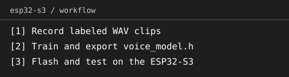

<p align="center">
  
</p>

<h1 align="center">ESP32-S3 Keyword Spotting</h1>
[](#hardware-and-software)
[](#2-train-and-export)
[](#3-flash-and-test)

Train a small speech recognition model to detect a wake phrase and two spoken commands. Record audio with an ESP32-S3 and an INMP441 microphone, train on your computer, and run inference on the board.


## Hardware and software

- `[+]` **Hardware.** ESP32-S3 N16R8 with 16 MB flash and 8 MB OPI PSRAM, an INMP441 microphone, and a USB data cable.
- `[+]` **Firmware.** Arduino IDE with Arduino-ESP32 (developed with 3.3.7) and a TensorFlow Lite Micro library that provides `tensorflow/lite/micro/micro_interpreter.h`.
- `[+]` **Training.** Python with TensorFlow, NumPy, and pyserial. Install these packages in step 1.

| INMP441 | ESP32-S3 |
| --- | --- |
| VDD | 3.3 V |
| GND and L/R | GND |
| SCK | GPIO 4 |
| WS | GPIO 5 |
| SD | GPIO 6 |

## 1. Record training and test audio

Choose a wake word or short phrase and two distinct commands in any language. Keep the dataset labels below because they define the model's output order.

| Label | What to record |
| --- | --- |
| `on` | The first command |
| `off` | The second command |
| `other` | Background noise, unrelated speech, and similar-sounding phrases |
| `wake` | Your wake word or phrase |

Upload [AudioRecorder.ino](training/AudioRecorder/AudioRecorder.ino) with **ESP32S3 Dev Module** selected. Enable **USB CDC On Boot** if you use native USB serial, then close the Arduino Serial Monitor before recording.

Run these commands in PowerShell from the repository root. Replace `COM8` with your serial port.

```powershell
Set-Location training
python -m pip install -r requirements.txt

foreach ($label in 'on', 'off', 'other', 'wake') {
    python record.py COM8 train $label 30
}
```

Speak after the countdown. Each WAV clip contains two seconds of mono, 16-bit audio sampled at 16 kHz. Record the test clips in a separate session so they reflect how you actually plan to use the model.

```powershell
foreach ($label in 'on', 'off', 'other', 'wake') {
    python record.py COM8 test $label 5
}
```

## 2. Train and export

From the `training` directory, run:

```powershell
python train.py --output model_output
```

The script trains on `dataset/train`, evaluates the exported TensorFlow Lite model on `dataset/test`, and prints a confusion matrix. Check for missed wake phrases and commands confused with each other. The Arduino header is saved as **`model_output/voice_model.h`**.

## 3. Flash and test

From the `training` directory, copy the model header and create your local configuration. If you already have a `secrets.h`, keep it and skip the second command.

```powershell
Copy-Item model_output/voice_model.h ../firmware/VoiceControl/
Copy-Item ../firmware/VoiceControl/secrets.example.h ../firmware/VoiceControl/secrets.h
```

Set your Wi-Fi credentials and local action URLs in `secrets.h`. Open [VoiceControl.ino](firmware/VoiceControl/VoiceControl.ino), select **ESP32S3 Dev Module**, **16 MB flash**, and **OPI PSRAM**, then upload. Enable **USB CDC On Boot** for native USB serial.

Open the Serial Monitor at **115200 baud**. Say the wake phrase, wait for `LISTENING`, and say a command. Check the scores for both commands and watch for false activations during normal conversation.

Git ignores the local configuration, WAV recordings, datasets, and default model output directories.
